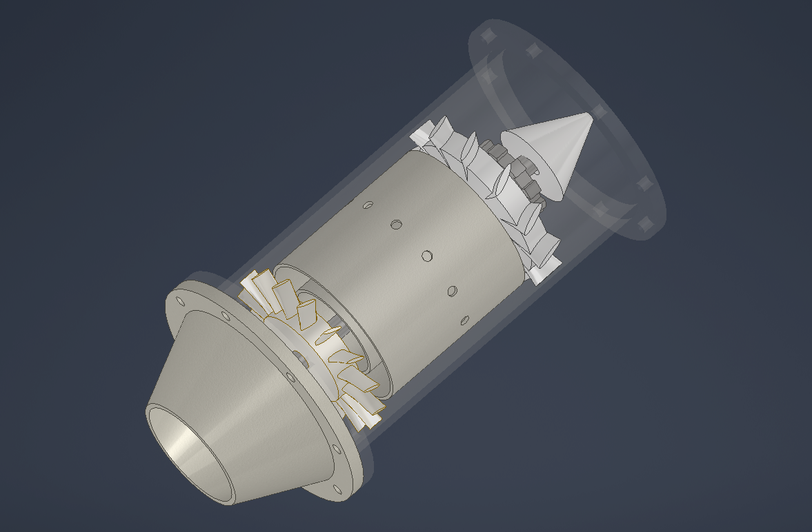
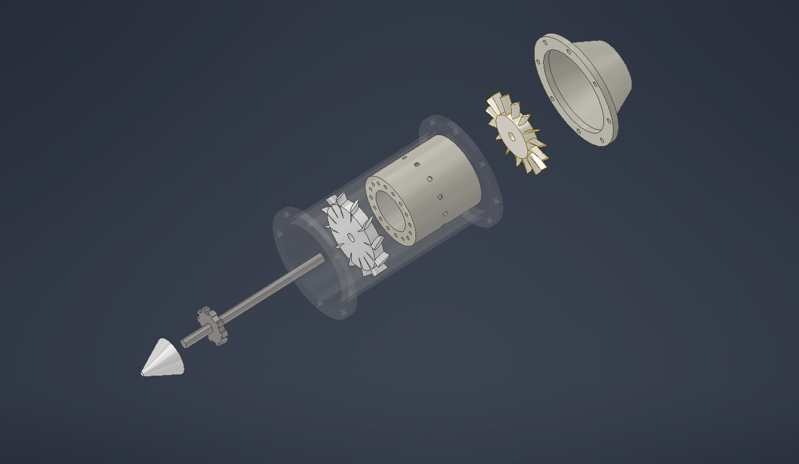
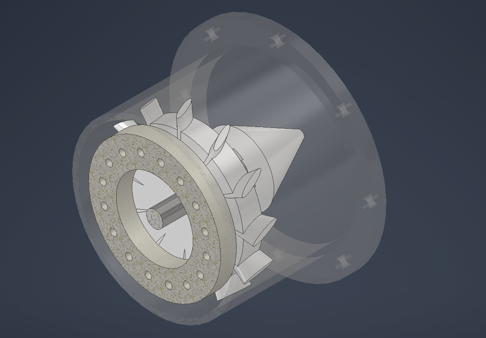
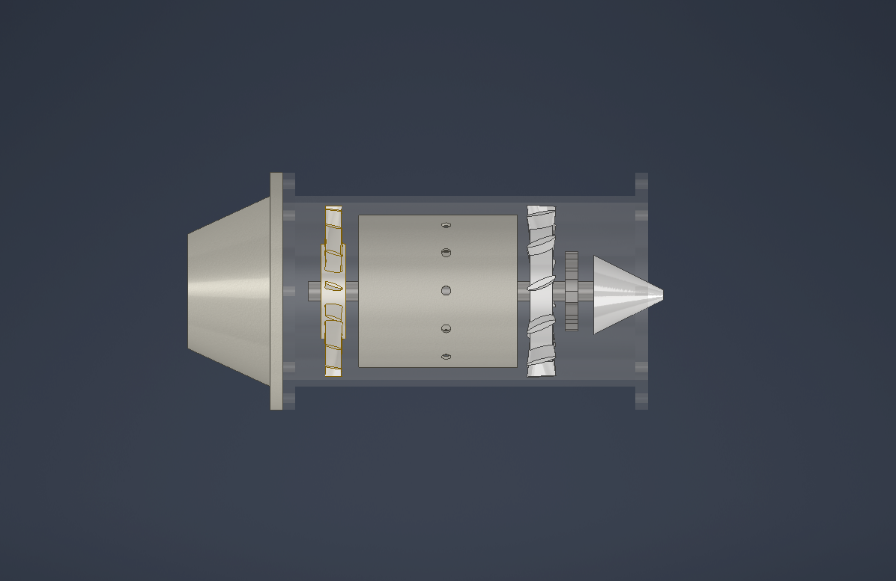

# Jet Engine Assembly (Autodesk Inventor)

A 3D CAD model of a turbojet engine, designed as a multi-part assembly in Autodesk Inventor. The model shows the main flow path of a turbojet: air enters at the nose cone, is compressed, burned in the combustor, expands through the turbine, and exits through the nozzle.



## Components

| # | Part | File | Description |
|---|------|------|-------------|
| 1 | Casing | `01_casing` | Outer housing with flanges, shown transparent to reveal the internals |
| 2 | Shaft | `02_shaft` | Central shaft connecting the compressor and turbine |
| 3 | Compressor rotor | `03_compressor_rotor` | Bladed rotor that compresses incoming air |
| 4 | Combustor liner | `04_combustor_liner` | Perforated liner where fuel and air burn |
| 5 | Turbine rotor | `05_turbine_rotor` | Extracts energy from the hot gas to drive the shaft |
| 6 | Nozzle | `06_nozzle` | Flanged exit cone that accelerates the exhaust |
| 7 | Nose cone | `07_nose_cone` | Streamlined inlet cone |

## Views

### Exploded view


### Internal layout


### Combustor and turbine (rear view)


### Side view


## Tools

- Autodesk Inventor [add your version, e.g. 2024]
- Parametric part modelling, assembly constraints, and a presentation file for the exploded view

## Repository structure

```
.
├── images/     # renders and screenshots
├── cad/        # Inventor files (.iam, .ipt, .ipn)
├── step/       # STEP export for use in other CAD software
└── README.md
```

## Opening the model

1. Download or clone this repository.
2. Open `cad/00_engine_assembly.iam` in Autodesk Inventor.
3. Keep the folder structure unchanged so Inventor can find the linked parts.

No Inventor? Import the STEP file from the `step/` folder into any CAD software (Fusion, SolidWorks, FreeCAD, etc.).

## Possible improvements

- Add a thrust and performance calculation sheet
- Run a stress or thermal simulation on the turbine rotor
- Add a motion animation of the rotating shaft assembly

## Author

Bhavan Kumar RT
